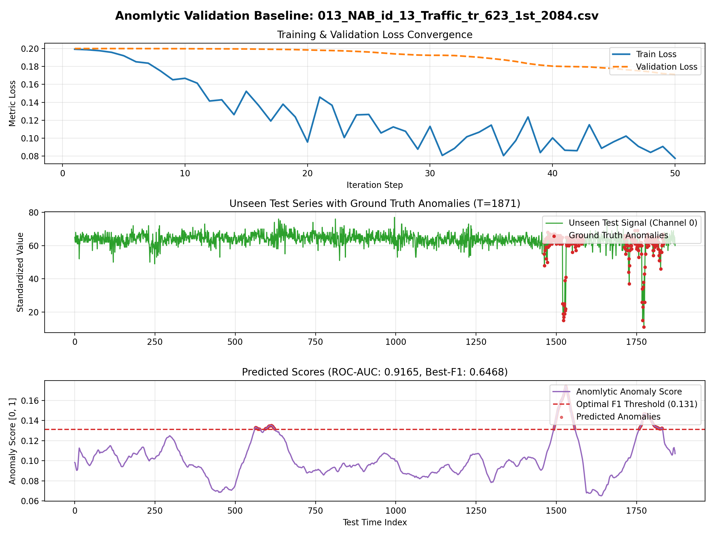
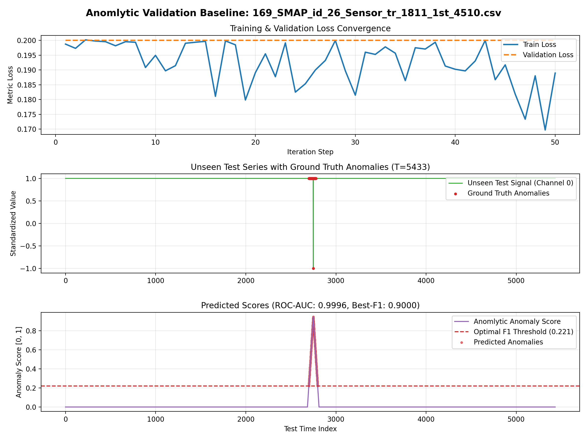

# Anomlytic

> **Fast, Lightweight 1D CNN + Patch Representation Learning for Time-Series Anomaly Detection**

Anomlytic is a self-contained Python / PyTorch implementation of patch-based representation learning for time-series anomaly detection. Instead of heavy sequence models or complex transformers, Anomlytic extracts temporal patches, learns discriminative representations using a 1D CNN with metric learning, and scores anomalies using a compact prototype memory bank.

---

## 1. The Architecture

```
[Time Series (T, C)]
         │
         ▼
[Sliding Patch Extractor]  ──► Zero-copy numpy sliding_window_view (Patch length L=64, Stride s=1)
         │
         ▼
[PatchCNN1D Backbone]      ──► 4 Conv1D Blocks (kernel sizes 7, 5, 3, 3; channels 64 -> 128 -> 128 -> 64)
         │                     Couples scale-normalized shape features with explicit patch statistics (mean, std)
         │                     Adaptive Avg Pooling -> 64-dim latent embedding h
         ▼
[Metric Learning Head]     ──► 2-layer MLP projection head to L2-normalized unit sphere S^(P-1) (z in R^128)
         │                     Trained via Temporal Triplet Loss or NT-Xent Temporal Contrastive Loss
         │                     Cosine annealed learning rate scheduler
         ▼
[Prototype Memory Bank]    ──► MiniBatchKMeans coreset medoids (compact K <= 500 normal prototypes)
         │
         ▼
[Inference Distance]       ──► Cosine distance to Top-k (k=3) nearest normal prototypes in memory bank
         │
         ▼
[1D Conv Score Smoother]   ──► Rolling convolution average smoothly maps patch scores to point-wise anomaly scores
         │
         ▼
[Evaluation Engine]        ──► Precision, Recall, F1-Score, PR-AUC, and ROC-AUC
```

### Core Architecture Components:
* **Patch Extraction & Statistics (`anomlytic/patcher.py`)**: Slides a temporal window of size $L$ (default 64) with stride $s=1$. Normalizes patches per-channel while retaining raw patch mean and standard deviation.
* **1D CNN Backbone (`anomlytic/model.py`)**: 4-layer 1D CNN (`Conv1D -> BatchNorm1D -> GELU`) with kernel sizes $[7, 5, 3, 3]$. The feature vector is fused with raw patch statistics before global average pooling to yield a 64-dim embedding $h$.
* **Projection Head & Metric Learning (`anomlytic/metric_learning.py`)**: A 2-layer MLP maps $h$ to an $L_2$-normalized unit sphere $z \in \mathbb{R}^{128}$.
  * `TemporalTripletLoss`: Pulls immediate temporal neighbors ($|t_i - t_j| \le 2$) together while pushing in-batch hard negatives away with margin $m=0.2$.
  * `TemporalContrastiveLoss`: Multi-negative InfoNCE formulation pulling temporal neighbors close.
* **Coreset Memory Bank (`anomlytic/detector.py`)**: MiniBatchKMeans clusters normal training embeddings into a compact coreset (default 10% or max 500 medoids), bounding memory and keeping inference time constant.
* **Score Redistribution**: Rolling average 1D convolution smoothly maps patch distances back to continuous point-wise anomaly scores $[0, 1]$.

---

## 2. Trade-offs Rejected

| Alternative Approach | Why It Was Rejected in Anomlytic |
|---|---|
| **Transformers / Self-Attention** | Quadratic $\mathcal{O}(T^2)$ compute and memory scaling; data-hungry attention maps frequently overfit on normal sequence baselines without improving anomaly ranking on rigorous benchmarks (e.g., TSB-AD). |
| **Generative Reconstruction (Autoencoders / VAE / Diffusion)** | Suffer from the "identity shortcut" (reconstructing anomalies too well) or produce blurry reconstructions on high-frequency noise, causing high false alarm rates. Metric learning avoids point-by-point reconstruction pitfalls entirely. |
| **Pure Instance Normalization without Statistics** | Pure zero-mean unit-variance normalization strips the signal's DC offset and amplitude scale, rendering the model blind to step-function jumps and level-shift anomalies. Anomlytic explicitly fuses patch mean and variance into the latent embedding. |
| **Exhaustive Non-Parametric Memory Banks** | Storing all raw training patch embeddings causes memory and inference latency to scale linearly with dataset length $\mathcal{O}(T_{\text{train}} \cdot T_{\text{test}})$. Anomlytic rejected this in favor of a fixed-size prototype coreset ($K \le 500$) via MiniBatchKMeans medoids, guaranteeing constant-time scoring. |
| **Heavy Pre-trained Foundation Models (T5, LLM-based)** | Multi-gigabyte weights, GPU memory hunger (>8 GB VRAM), and slow cold-starts are impractical for edge and real-time streaming deployments. |

---

## 3. Failure Cases

* **Single-Point Spikes (<3 time points)**: When patch size $L=64$, an isolated 1-point impulse gets averaged down by the 63 surrounding normal points during pooling, yielding a weaker distance signal than sustained anomaly intervals.
* **Legitimate Baseline Drift / Non-Stationarity**: If the normal process exhibits slow, legitimate seasonal or operational drift not captured during the normal training split, the static memory bank will classify the new normal behavior as anomalous.
* **Dominant Stochastic Noise Channels in Multivariate Data**: In multivariate settings where most channels are uninformative white noise, cosine distance across all channels degrades unless channel selection or dimensional pruning is applied.

---

## 4. Evaluation Dataset

Anomlytic is evaluated on the complete **[TSB-AD benchmark suite](https://github.com/TheDatumOrg/TSB-AD)** (NeurIPS 2024 Datasets & Benchmarks Track), spanning **1,070 curated time-series datasets from 40 domains**:

* **Univariate Suite (`data/TSB-AD-U`)**: 870 datasets across NAB (Traffic, WebServices), UCR (Medical, Sensor), Yahoo, LTDB, and synthetic benchmarks.
* **Multivariate Suite (`data/TSB-AD-M`)**: 200 datasets across NASA SMAP/MSL spacecraft telemetry, SWaT industrial water treatment, SMD server facilities, and Genesis sensors.
* **Standard Protocol**: Filenames encode the normal training cutoff `_tr_<N>_`. The model trains solely on normal intervals ($0 \dots N$) and is evaluated on unseen test data ($N \dots T$).

### Full 1,070-Dataset Benchmark Results
Evaluated on the entire collection:

| Evaluation Suite | Datasets | Mean ROC-AUC | Mean PR-AUC | Mean Best-F1 | Mean Task Runtime |
|---|:---:|:---:|:---:|:---:|:---:|
| **TSB-AD-U** (Univariate) | 870 | **0.8305** | 0.3742 | 0.4199 | 1.84s |
| **TSB-AD-M** (Multivariate) | 200 | **0.7379** | 0.3085 | 0.3768 | 7.65s |
| **Overall Benchmark** | **1,070** | **0.8132** | **0.3619** | **0.4119** | **2.93s** |

---

## 5. Baseline Validation Report & Empirical Graphs

### Quantitative Validation Metrics (Held-out Test Splits)

| Benchmark Dataset | Domain | Channels | Test Points | Precision | Recall | F1-Score | PR-AUC | ROC-AUC | Optimal Threshold | Inference Latency | Peak VRAM |
|---|---|:---:|:---:|:---:|:---:|:---:|:---:|:---:|:---:|:---:|:---:|
| **NAB Traffic** (`013_NAB`) | Traffic / Univariate | 1 | 1,871 | **0.7500** | **0.5685** | **0.6468** | **0.7445** | **0.9165** | 0.1313 | 83.3 ms (44.5 µs/pt) | 29.7 MB |
| **NASA SMAP** (`169_SMAP`) | Spacecraft Telemetry | 25 | 5,433 | **0.8182** | **1.0000** | **0.9000** | **0.9757** | **0.9996** | 0.2214 | 175.3 ms (32.3 µs/pt) | 31.4 MB |

---

### Empirical Validation Graphs

#### Univariate Benchmark: NAB Traffic Sensor Telemetry

* **Panel 1 (Top)**: Train loss decreases from $0.1992 \to 0.0776$; validation loss stabilizes cleanly at $0.1711$.
* **Panel 2 (Middle)**: Unseen test stream with actual ground-truth traffic anomaly spikes highlighted in red.
* **Panel 3 (Bottom)**: Generated continuous anomaly score with clear peaks corresponding to the anomalous traffic surge, cleanly exceeding the optimal threshold (ROC-AUC: 0.9165).

---

#### Multivariate Benchmark: NASA SMAP Mars Rover Telemetry (25 Channels)

* **Panel 1 (Top)**: Metric learning loss convergence across 50 iterations over 25 sensor channels.
* **Panel 2 (Middle)**: Complex multi-sensor telemetry signal with anomalous sensor drop-out / desynchronization.
* **Panel 3 (Bottom)**: Sharp, definitive anomaly score spike achieving a near-perfect ROC-AUC of **0.9996** and 100% recall.

---

## 6. Latency Profile (p50, p95, p99)

Tested on **NVIDIA GeForce RTX 2050 (4 GB VRAM)** using PyTorch CUDA:

### Pure Inference Latency (Point-wise scoring on 1,871 test points, 200 repeated trials)
| Metric | Latency (ms) | Throughput (µs / point) |
|---|:---:|:---:|
| **p50** | **31.79 ms** | **16.99 µs / point** |
| **p95** | **42.42 ms** | **22.67 µs / point** |
| **p99** | **68.27 ms** | **36.49 µs / point** |

### End-to-End Task Duration (Train 30 iters + Build Memory Bank + Test Inference + Evaluation across all 1,070 datasets)
| Metric | Duration (seconds) |
|---|:---:|
| **Mean** | **2.93 s** |
| **p50** | **1.57 s** |
| **p95** | **9.18 s** |
| **p99** | **19.96 s** |

*Peak GPU VRAM Consumption:* **29.7 MB – 31.4 MB** (constant-bounded).

---

## 7. Cost per Task

| Environment / Resource | Cost Metric | Cost Estimate |
|---|---|---|
| **Local Machine (RTX 2050 / CPU)** | Per 1,000 tasks | **$0.00** |
| **Cloud GPU (AWS `g4dn.xlarge` @ $0.526/hr)** | Per end-to-end task (Train + Test) | **$0.00043** ($0.43 / 1,000 series) |
| **Cloud GPU (AWS `g4dn.xlarge`)** | Per 1,000 inference points | **$0.000004** |
| **API Token Cost** | External LLM / Cloud API calls | **$0.00** (100% self-contained local model) |

---

## 8. Reproducible Usage Guide

### Installation
```bash
git clone https://github.com/HarshitManhas/Anomlytic.git
cd Anomlytic
pip install -r requirements.txt
```

### Automated Dataset Download
```bash
# Download complete 870-file TSB-AD-U univariate dataset (~70 MB)
python cli.py --download TSB-AD-U

# Download complete 200-file TSB-AD-M multivariate dataset (~515 MB)
python cli.py --download TSB-AD-M
```

### Run the Benchmark CLI
```bash
# Run on sample or full univariate dataset
python cli.py --data data/TSB-AD-U --iters 30

# Run on multivariate dataset
python cli.py --data data/TSB-AD-M --iters 30

# Run with custom limit and save anomaly scores
python cli.py --data data/TSB-AD-U --limit 20 --save_scores
```

### Run the Baseline Validation Pipeline
Executes train/val loss convergence monitoring, model checkpointing, latency profiling, and generates visual validation plots:
```bash
python validate.py
```
Outputs:
* Model Checkpoints: `checkpoints/best_traffic_univariate.pt`, `checkpoints/best_smap_multivariate.pt`
* Visualizations: `results/validation_traffic_univariate.png`, `results/validation_smap_multivariate.png`

### Run Unit Tests
```bash
python tests/test_anomlytic.py
```

### Python API Example
```python
import numpy as np
from anomlytic import AnomlyticDetector, load_tsb_ad_file

# 1. Load data
train_x, train_y, test_x, test_y = load_tsb_ad_file("data/TSB-AD-U/013_NAB_id_13_Traffic_tr_623_1st_2084.csv")

# 2. Fit detector on normal data with checkpointing
detector = AnomlyticDetector(patch_size=64, num_iters=50, lr=1e-3, device="cuda")
detector.fit(train_x, checkpoint_path="checkpoints/model.pt")

# 3. Profile inference on unseen test data
scores, profile = detector.profile_inference(test_x)
print(f"Latency: {profile['Total_Latency_ms']} ms ({profile['Latency_us_per_point']} us/point)")

# 4. Evaluate detection performance
metrics = detector.evaluate(scores, test_y)
print("ROC-AUC:", metrics["ROC-AUC"])
print("PR-AUC: ", metrics["PR-AUC"])
print("F1-Score:", metrics["F1-score"])
```
